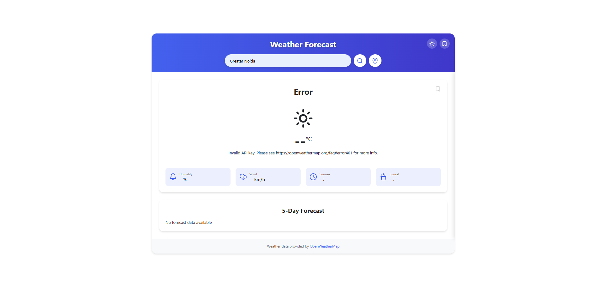

# Weather App

A weather forecast web application that lets users search for a location and view current weather details and a 5-day forecast.

## Screenshot

## Features

- Search for weather by city or location
- Option to use the current location
- Display current weather information
- Show humidity and wind details
- Display sunrise and sunset times
- 5-day weather forecast section
- Light/dark theme control
- Save or bookmark a location

## Built With

- HTML
- CSS
- JavaScript
- OpenWeatherMap API

## Getting Started

1. Clone or download this repository.
2. Open the project folder in your code editor.
3. Add your OpenWeatherMap API key in the JavaScript file where the API key is configured.
4. Open `index.html` in your browser.

## API Configuration

This project uses the OpenWeatherMap API to retrieve weather information. Create an API key through the OpenWeatherMap website and configure it in the project before running the app.

**Note:** The screenshot shows an API key error, so live weather data will not load until a valid API key is configured.

## Repository

[View Weather App on GitHub](https://github.com/mohitsingh40/Weather-App)
